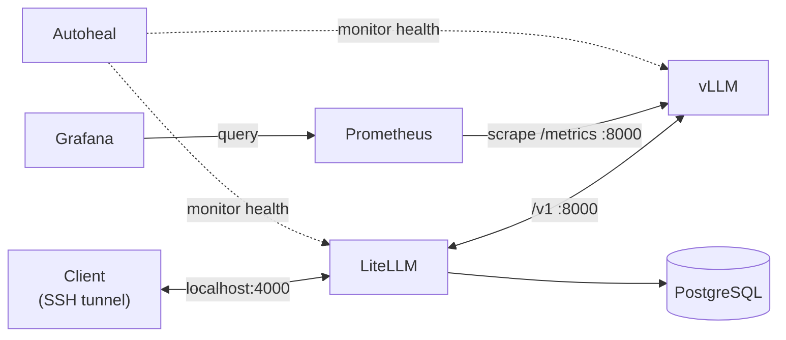

# Self-hosted LLM server

Host an open-source LLM on one GPU machine and let other users reach it through a single, fixed, OpenAI-compatible endpoint over SSH port-forwarding.

## 1. Motivation

Open-source models are free to run, and a local GPU keeps prompts and data on your own machine. SSH port-forwarding lets others in the same network use the model without exposing any port to the network. Access is limited to people with an SSH account, and each person gets their own API key, so usage can be tracked per user.

**Limitation: one GPU.** This setup serves one model at a time, so it has no autoscaling and no concurrent multi-model hosting. With more than one GPU, consider Kubernetes instead of Docker Compose.

**Kubernetes over Docker with multiple GPUs**

- **KEDA for dynamic scaling.** KEDA (Kubernetes Event-driven Autoscaling) watches load metrics (e.g. pending or
  running requests from vLLM's Prometheus metrics) and
  scales replicas up or down automatically with available GPU. 
- **KV-cache-aware routing.** A plain round-robin load
  balancer sends a repeated prompt to a replica that has not cached it, so the prefill is recomputed.
  The vLLM production-stack router can route by session ID or prefix, and
  has KV-cache-aware options, so requests land on the replica most likely to
  already hold the cache. The result is lower time-to-first-token and less
  wasted GPU compute.
- **Ready-made Helm chart.** There are Helm charts that provide ready-made templates for LLM hosting. Example is the **vLLM production-stack** repo that
  packages the serving engines, request router, and a Prometheus/Grafana
  observability stack into one install, with options for KEDA autoscaling and multiple models.


**Desired outcome of setup**

- One fixed endpoint (`http://localhost:4000/v1`, model `local-llm`) for whatever model runs behind it.
- High concurrency and throughput.
- Automatic restart if a service goes down.
- Token and cost usage tracked over time, per user.
- Server-level and request-level metrics to evaluate performance of inference model, including latency, time-to-first-token and KV-cache usage.
- Easy model swaps without changing the client-facing API.

## 2. Containers

| Container | Role | Port (host) |
|---|---|---|
| `litellm` | Unified endpoint / proxy | `127.0.0.1:4000` |
| `vllm` | Inference engine | none (internal `8000`) |
| `postgres` | Database for LiteLLM keys and spend | none (internal `5432`) |
| `prometheus` | Metrics collection | `127.0.0.1:9090` |
| `grafana` | Metrics dashboard | `127.0.0.1:3000` |
| `autoheal` | Side car to restart unhealthy containers | none (no network) |

### How each component helps

**LiteLLM** (aims: single endpoint, usage tracking)
- Exposes one OpenAI-compatible API and hides the backend model behind the fixed name `local-llm`.
- Issues a virtual key per user to enable tracking of each user's token usage and cost.
- Possible to set budgets and rate limits per user or key.
- Includes an Admin UI at `/ui` for usage tracking.

**vLLM** (aim: concurrency and throughput)
- Continuous batching: new requests join the running batch at every step, so the GPU doesn't wait for the slowest request.
- PagedAttention: the KV cache is allocated in small pages, which cuts memory waste and fits more concurrent requests.

**Monitoring and reliability** (aims: auto-restart, observability)
- **autoheal** restarts any container labelled `autoheal=true` whose healthcheck fails (`vllm`, `litellm`). Together with `restart: unless-stopped`, the stack recovers from crashes and reboots.
- **Prometheus** scrapes vLLM's `/metrics` endpoint at regular interval (15s) and keeps history (30 days is default).
- **Grafana** process metrics and display then onto dashboards, such as latency, throughput and KV-cache usage.

### Architecture



## 3. Design choices

- **Persistent storage using named volume `hf_cache` on the vLLM container.** Model weights are downloaded once and kept, so restarts and switching back to a previous model do not require re-download.
- **LiteLLM, Prometheus and Grafana bind to `127.0.0.1`.** Binding to the host allows the admin to open the different user interfaces at `localhost:<port>` for monitoring the various observability services and access the hosted model in vllm via `localhost:4000`.
- **Including approximate cost despite free open-source models.** Per-token rates (`input_cost_per_token`, `output_cost_per_token`) in `config/litellm_config.yaml` are used by LiteLLM to calculate the cost usage, providing an estimate on the cost of using comparable models.

## 4. Host setup (Windows)

Assumes Docker Desktop (with GPU support) is installed. Run PowerShell as **Administrator**.

**a) Install the SSH server, start it and keep it active**

```powershell
Add-WindowsCapability -Online -Name OpenSSH.Server~~~~0.0.1.0
Start-Service sshd
Set-Service -Name sshd -StartupType Automatic   
```

**b) Create an account for each user in Windows SSH server**

```powershell
net user <user name> <password> /add
```

**c) Set environment variables**  
In `.env`, generate secrets for the following variables `LITELLM_MASTER_KEY`, `POSTGRES_USER`, `POSTGRES_PASSWORD`, `POSTGRES_DB`, `GRAFANA_ADMIN_USER` and `GRAFANA_ADMIN_PASSWORD`. The LiteLLM and Gafana credentials allow to login to LiteLLM and Gafana admin UI respectively. PostgreSQL credentials are for non-admin user for LiteLLM to add keys and usage data into PostgreSQL. FA  

**d) Start the stack**

```powershell
docker compose up -d
```

The start downloads the model to be hosted in vllm (if weights are not already downloaded), which can take some while.

**e) Check the logs**

```powershell
docker compose ps
docker compose logs vllm
```

A common error is not enough GPU memory for the model. Fix it in [config/vllm.yaml](config/vllm.yaml): lower `max-model-len`, `gpu-memory-utilization` or `max-num-seqs`, or pick a smaller model. Then run `docker compose restart vllm`.

**f) Check access to interfaces**   
Using the generated credentials in `.env`, access the admin UI to ensure obervability for admin.

- LiteLLM: `http://localhost:4000/ui` (`admin` and `LITELLM_MASTER_KEY`)
- Grafana: `http://localhost:3000` (`GRAFANA_ADMIN_USER` and `GRAFANA_ADMIN_PASSWORD`)

**g) Generate a LiteLLM virtual key per user**  
Expose the LiteLLM master key from `.env`. and create virtual key for users. 

Possible to apply budget, concurrency and request limits, model access,duration of validity of key for each key using the optional variables like `max_budget`,`budget_duration`, `rpm_limit` and `tpm_limit`.
Possible to have multiple keys per user. (different key alias, but same user_id). The model is fixed as `local-llm` since this the only hosted model.

```bash
export LITELLM_MASTER_KEY='sk-your-actual-key'

curl -X POST http://localhost:4000/key/generate \
  -H "Authorization: Bearer $LITELLM_MASTER_KEY" -H "Content-Type: application/json" \
  -d '{"user_id": "<user name>", "key_alias": "<key name>", "models": ["local-llm"]}'
```

 The key to give the user is the value starting with `sk-` in the `key` field of the response.

**h) Information to send each user:**   
Their SSH username and password, the host machine's IP address (`ipconfig`), and their LiteLLM virtual key.

## 5. Host clean up

**a) Delete a user**

```powershell
net user <user name> /delete
```

**b) Stop and remove the SSH server**

```powershell
Stop-Service sshd
Set-Service -Name sshd -StartupType Disabled
Remove-WindowsCapability -Online -Name OpenSSH.Server~~~~0.0.1.0
```

**c) Delete a LiteLLM virtual key**
```bash
export LITELLM_MASTER_KEY='sk-your-actual-key'

curl -X POST http://localhost:4000/key/delete \
  -H "Authorization: Bearer $LITELLM_MASTER_KEY" \
  -H "Content-Type: application/json" \
  -d '{"key_aliases": ["<key name>"]}'
```

**d) Remove all containers**
To stop the stack, run `docker compose down`. Add `-v` to delete the model weights and database volumes.

## 6. Client access to hosted model (via SSH port-forwarding)

Assumes [uv](https://docs.astral.sh/uv/) is installed and `pyproject.toml`, `uv.lock` and `test_vllm.py` are downloaded from this repo into one folder.

**a) Start SSH port-forwarding to LiteLLM (port 4000)**
```bash
 ssh -N -L 4000:127.0.0.1:4000 <ssh_username>@<host_ip>
```

Enter the SSH password. The terminal may look frozen with no output. That is normal. **Keep it open** while using the model.

**b) Add the LiteLLM virtual key.**  
In`.env` file in the same folder, add the variable with provided LiteLLM virtual key.

```env
LITELLM_API_KEY=sk-...
```

**c) Create the Python environment**

```bash
uv sync
```

**d) Run the test script**

```bash
uv run test_vllm.py
```

The script sends concurrent requests to `model="local-llm"` and prints throughput and latency. `N` (total requests) and `C` (concurrency) can be overridden via environment variables.

This test script checks if user can access the model. If succeed, user can use model for their own inference at the same endpoint and model name.
## 7. Additional information

**a) Change the hosted model or its configuration**

Edit [config/vllm.yaml](config/vllm.yaml) (`model`, `max-model-len`, etc.) but keep `served-model-name: local-llm`. Then:

```powershell
docker compose restart vllm
```

**b) Change the model cost**

Edit `input_cost_per_token` and `output_cost_per_token` in [config/litellm_config.yaml](config/litellm_config.yaml). Then:

```powershell
docker compose restart litellm
```

Past requests keep the cost computed at the time.

**c) Grafana dashboard**

Which Prometheus metrics are shown, and how, is defined in [config/grafana/dashboards/vllm.json](config/grafana/dashboards/vllm.json). Edit it to change the display or add and remove metrics. Dashboard templates are available online (for example in the [vLLM GitHub repo](https://github.com/vllm-project/vllm/tree/main/examples/observability/dashboards/grafana)) and can be adapted.
